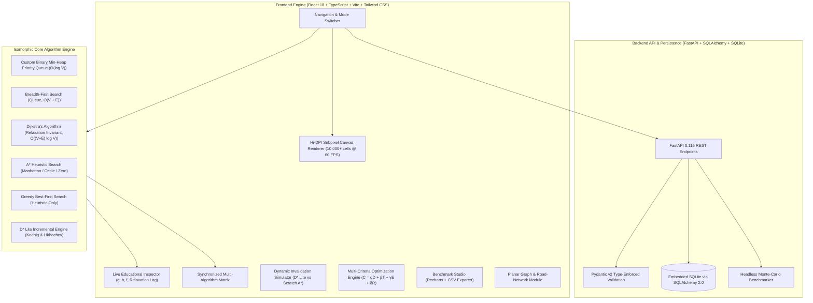

# PathWise — Intelligent Pathfinding, Visualization & Optimization Platform

[](https://github.com/)
[](https://react.dev/)
[](https://www.typescriptlang.org/)
[](https://fastapi.tiangolo.com/)
[](https://www.python.org/)
[](LICENSE)

An academically rigorous, production-grade interactive platform for graph search, algorithmic visualization, dynamic incremental replanning, multi-criteria route optimization, and empirical benchmarking.

---

## 1. System Architecture

PathWise employs a decoupled full-stack architecture combining a 60 FPS sub-pixel Canvas frontend engine with an asynchronous Python FastAPI headless benchmarking service:



---

## 2. Key Modules & Features

### Core Module A: Interactive Map & Environment Builder
- High-performance HTML5 Canvas grid renderer supporting configurations from $10 \times 10$ up to $100 \times 100$.
- Click-and-drag drawing of walls, eraser tool, and weighted terrain zones (Sand $2\times$, Mud $3\times$, Water $5\times$, Hazard Zone $10\times$).
- Draggable Start and Target nodes with immediate recalculation.
- 4-directional and 8-directional movement with **strict corner-cutting prevention** across blocked cells.

### Core Module B: Algorithm Engine (Implemented from Scratch)
- **Custom Min-Binary-Heap**: Array-backed priority queue with $\mathcal{O}(\log V)$ bubble-up/sink-down and secondary priority tie-breaking.
- **Breadth-First Search (BFS)**: Unweighted edge-count optimization.
- **Dijkstra's Algorithm**: Optimal path cost exploration for non-negative weighted graphs.
- **A* Search**: Guided heuristic evaluation ($f(n) = g(n) + h(n)$) with Manhattan, Octile, Euclidean, Chebyshev, and Zero heuristics. Admissibility preserved on weighted terrain through minimum weight scaling factor.
- **Greedy Best-First Search**: Heuristic proximity search highlighting concave trap vulnerabilities and suboptimality.
- **D* Lite Incremental Replanning**: Koenig & Likhachev reverse search with $g$ and $rhs$ values, key modifier $k_m$, and vertex consistency propagation.

### Core Module C: Step-by-Step Visualization & Educational Inspector
- Start, pause, resume, step forward, run instantly, and variable speed slider (1x to 100x).
- Real-time mathematical inspector displaying $g(n)$, $h(n)$, $f(n)$, priority rank, and neighbor relaxation status.

### Core Module D: Side-by-Side Algorithm Comparison
- Synchronized multi-algorithm view comparing up to 4 algorithms simultaneously on identical topologies.
- Recharts bar and radar graphs comparing Nodes Expanded, Nodes Discovered, Path Cost, and Runtimes.
- Automated empirical synthesis paragraphs derived from actual measurements.

### Core Module E: Dynamic Replanning Simulator
- Interactive obstacle insertion on active paths.
- Compares D* Lite incremental updates with recomputing A* from scratch, displaying time and node expansion speedups.

### Core Module F: Multi-Criteria Route Optimization
- Linear scalarization model:
  $$C(e) = \alpha \cdot \text{Distance}(e) + \beta \cdot \text{Time}(e) + \gamma \cdot \text{Energy}(e) + \delta \cdot \text{Risk}(e)$$
- Adjustable coefficient sliders and real-time path diversion visualization.

### Core Module G: Scenario Management & Persistence
- 10 built-in presets (Empty Grid, Recursive Division Maze, Narrow Corridor, Dense Obstacles, Multi-Terrain Biome, Competing Routes, Unreachable Destination, Dynamic Corridor, Large Grid Benchmark, Warehouse Logistics).
- Custom scenario saving, loading, renaming, deleting, and JSON import/export with schema validation.
- SQLite backend persistence via SQLAlchemy.

### Core Module H: Benchmark Studio & CSV Exporter
- Headless Monte-Carlo benchmark suite across varying grid dimensions ($15 \times 15$ to $50 \times 50$) and obstacle densities (10% to 45%).
- Statistical aggregation across multiple repetitions.
- Direct CSV export of all raw experimental trial runs.

### Advanced Module: Planar Graph & Road-Network Routing
- Interactive planar road graphs with named intersections and weighted road segments.
- Preset city networks (Downtown Grid, Orbital Ring Road, Logistics Port).
- Dijkstra and A* shortest path routing over graph nodes with Euclidean distance heuristic.

---

## 3. Technology Stack

- **C++ Engine**: Modern C++14/C++17, Custom Templated BinaryHeap, CMake, GCC/Clang/MSVC.
- **Frontend**: React 18, TypeScript (Strict), Vite, Tailwind CSS, Lucide Icons, HTML5 Canvas, Recharts.
- **Backend**: Python 3.9+, FastAPI 0.115, Pydantic v2, SQLAlchemy 2.0, SQLite, Pytest, Uvicorn.
- **Testing**: Vitest, React Testing Library, Pytest, C++ Native Assertions.

---

## 4. Quickstart & Installation

### Prerequisites
- Node.js (v18+)
- Python (v3.9+)

### 1. Setup Backend
```bash
cd backend
python -m pip install -r requirements.txt
python -m uvicorn app.main:app --host 0.0.0.0 --port 8000 --reload
```
The FastAPI backend will start at `http://localhost:8000`. Interactive API documentation is available at `http://localhost:8000/docs`.

### 2. Setup Frontend
```bash
cd frontend
npm install
npm run dev
```
The Vite development server will open at `http://localhost:5173`.

---

## 5. Verification & Testing

### Frontend Test Suite (Vitest)
```bash
cd frontend
npm test
```
*Executes 13 unit tests verifying BinaryHeap, Heuristics, Corner-Cutting Prevention, BFS, Dijkstra, A*, Greedy, and D* Lite.*

### Backend Test Suite (Pytest)
```bash
cd backend
python -m pytest tests/ -v
```
*Executes 8 comprehensive unit and integration tests across Python algorithm engines, corner-cutting physics, and FastAPI endpoints.*

---

## 6. Academic Documentation Index

Detailed documentation files are available in the [`docs/`](docs/) directory:
- [`problem-statement.md`](docs/problem-statement.md): Formal research question, hypotheses, and scope.
- [`system-architecture.md`](docs/system-architecture.md): Component diagrams, dataflow, and API specifications.
- [`algorithm-design.md`](docs/algorithm-design.md): Mathematical formulations, complexity bounds, and proofs.
- [`testing-strategy.md`](docs/testing-strategy.md): Automated verification and quality assurance.
- [`benchmark-methodology.md`](docs/benchmark-methodology.md): Monte-Carlo experimental design and metrics.
- [`limitations-and-future-scope.md`](docs/limitations-and-future-scope.md): Boundary conditions and research roadmap.
- [`viva-questions.md`](docs/viva-questions.md): Major project defense questions and answers.
- [`project-report-outline.md`](docs/project-report-outline.md): Formal academic report outline.

---

## 7. License
MIT License. Developed for Academic Research and Computer Science Major Project evaluation.
