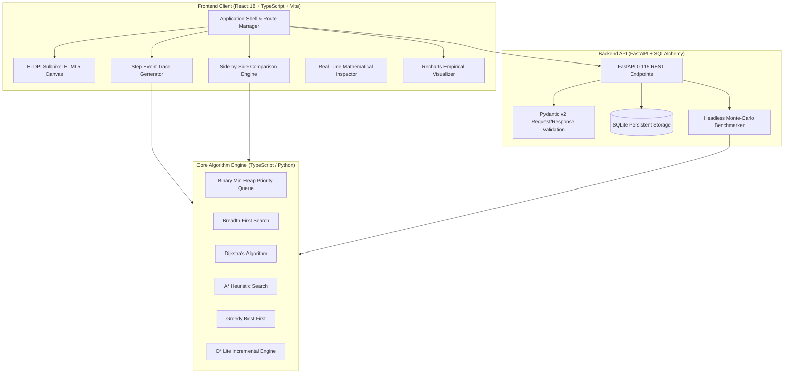

# System Architecture & Technical Design

## 1. Architectural Overview
**PathWise** employs a decoupled full-stack architecture that combines client-side interactive visual computing with server-side scientific execution and persistence.

## 2. Frontend Layer Design
- **React 18 & TypeScript (Strict Mode)**: Strict type safety across all graph coordinates, events, and metrics.
- **High-Performance Canvas**: Direct 2D canvas manipulation avoids thousands of DOM nodes, ensuring smooth 60 FPS rendering on grids exceeding 100x100.
- **State Decoupling**: Animation playback is separated from the underlying graph search algorithm. The algorithm produces an execution trace in sub-millisecond time, which can then be played back, paused, or stepped through.

## 3. Backend Layer Design
- **FastAPI**: Provides asynchronous RESTful endpoints with automatic OpenAPI / Swagger documentation.
- **Pydantic v2**: Enforces strict request payloads, coordinate bounds, and non-negative terrain weights.
- **SQLAlchemy 2.0 & SQLite**: Stores saved map scenarios, obstacle layouts, movement parameters, and historical benchmark results.
- **CORS Support**: Configured to seamlessly serve both local Vite development (`localhost:5173`) and standalone deployments.

## 4. Endpoints Specification
- `GET /api/health`: Health status and registered algorithm list.
- `POST /api/pathfinding/run`: Headless execution of single algorithm.
- `POST /api/pathfinding/compare`: Headless multi-algorithm comparative matrix.
- `POST /api/pathfinding/replan`: Incremental D* Lite vs scratch A* recalculation.
- `GET /api/scenarios`: List all persistent scenarios.
- `POST /api/scenarios`: Create and persist scenario.
- `GET /api/scenarios/{id}`: Retrieve scenario by ID.
- `PUT /api/scenarios/{id}`: Update existing scenario.
- `DELETE /api/scenarios/{id}`: Delete scenario.
- `POST /api/benchmarks/run`: Run multi-size, multi-density statistical benchmark.
- `GET /api/benchmarks`: List benchmark history.
- `GET /api/benchmarks/export/csv`: Export raw benchmark data to CSV.
